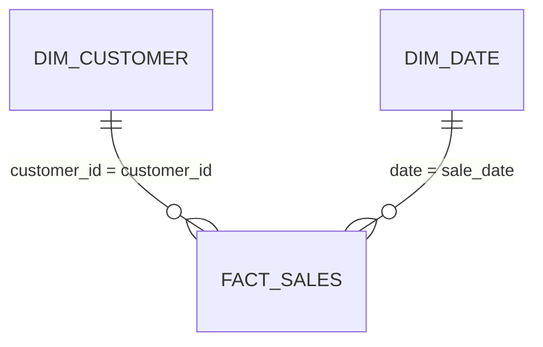

# 📊 Retail Sales Analysis: Tableau & Power BI kit

Everything needed to rebuild this project as a Power BI and Tableau dashboard in under an hour: model-ready data, ready-to-paste DAX measures and Tableau calculated fields, a matching colour theme, a page-by-page layout, and the exact numbers your finished dashboard should show.

> **Interactive web version:** [scarface96.github.io/sql_retail_sales_p1](https://scarface96.github.io/sql_retail_sales_p1/). The kit uses the same cleaned data, so the numbers will match.

## What's in this folder

| File | What it is |
|---|---|
| `data/fact_sales.csv` | one row per transaction (cleaned, 3 incomplete rows removed): date, time, hour, shift, customer, gender, age band, category, quantity, price, total |
| `data/dim_customer.csv` | one row per customer: recency, frequency, monetary value, R/F/M scores and RFM segment from the SQL window functions |
| `data/dim_date.csv` | one row per day, 2022-2023: year, quarter, month, weekday |
| `powerbi/measures.dax` | Every DAX measure, with its number format |
| `powerbi/theme.json` | Report theme in the portfolio's teal-and-amber colours |
| `tableau/calculated_fields.md` | Every calculated field, plus how to connect the tables |
| `tableau/Preferences.tps` | The same colours as Tableau palettes |
| `kpis.json` | Headline numbers, for checking your build |
| `build_bi.py` | Regenerates everything here from the repo's own cleaning code: `python -m bi.build_bi` |

## Data model

A star schema: one fact table, small lookup tables around it, single-direction many-to-one relationships.

## Dashboard design

Canvas 1280 × 720. Light page background, white cards, teal for the main series, amber to highlight, red only for bad news.

### Page 1: Sales overview
*What sells, and when?*

- KPI cards: Total Sales · Transactions · Customers · Avg Transaction Value
- Line chart: Total Sales by dim_date[month] (sort by month_no), legend dim_date[year], shows the Sept-Dec surge in both years
- Bar chart: Total Sales by category with Category Share in the tooltip
- Column chart: Transactions by fact_sales[sale_hour], plus a bar by shift

### Page 2: Customers
*Who are the best customers, and who is slipping away?*

- Bar chart: Customers and Total Sales by dim_customer[segment]
- Scatter: x = dim_customer[frequency], y = dim_customer[monetary], legend = segment, details = customer_id
- Matrix heatmap: rows age_band, columns category, values Total Sales
- Table: top 10 customers by Total Sales with segment

## Build it in Power BI

1. **Get data → Text/CSV** and load each file in `bi/data/`. Check that date columns come in as *Date* and IDs as *Whole number* or *Text*.
2. In **Model view**, create the relationships (many-to-one, single direction): `fact_sales[customer_id]` → `dim_customer[customer_id]`; `fact_sales[sale_date]` → `dim_date[date]`.
3. Select `dim_date` → **Table tools → Mark as date table** → `date`.
4. **Home → Enter data**, name the table `_Measures`, load it, then add each measure from `powerbi/measures.dax` and set the format given above it.
5. **View → Themes → Browse for themes** → `powerbi/theme.json`.
6. Build the pages above. Add a title text box on each page with the question it answers.
7. Check your cards against **Check your numbers** below.
8. Save as `Retail Sales Analysis.pbix` in the repo root.

## Build it in Tableau

1. Copy `tableau/Preferences.tps` to `Documents/My Tableau Repository/` (or merge its palettes into the one there) and restart Tableau.
2. Connect the data as described at the top of `tableau/calculated_fields.md`.
3. Create the calculated fields in that file.
4. Build one sheet per chart above, then a dashboard per page at 1280 × 720 (Fixed size). Use the *Tony Mulunda* palettes for colour.
5. Check your BANs against **Check your numbers** below.
6. **File → Save to Tableau Public**, then save the packaged workbook (`.twbx`) in the repo root.

## Check your numbers

Your finished dashboard (no filters applied) should show:

| Measure | Value |
|---|---|
| Total sales | 911,720 |
| Transactions | 1,997 |
| Customers | 155 |
| Average transaction value | 456.54 |
| Units sold | 5,018 |
| Top category by sales | Electronics (313,810) |
| Rows removed in cleaning | 3 |
| Champions (RFM segment) | 40 |
| Date range | 2022-01-01 to 2023-12-31 |

If a number is off, the usual causes are a relationship pointing the wrong way, a date column loaded as text, or a missing join.

## Notes on the data

- `cogs` is above the selling price in 309 rows of the source data, so a profit measure would be misleading. The kit leaves profit out on purpose; mention this data-quality finding on the dashboard rather than charting it.

## Publish and show it off

- **Tableau Public:** after saving, copy the share link and add it to the main README next to the live web report.
- **Power BI:** *Publish to web* needs a work or school account. Without one, add a screenshot of each page to `docs/images/` and link the `.pbix` from the README.
- Take a 1280 × 720 screenshot of page 1 and put it at the top of the main README, so it's the first thing a recruiter sees.
